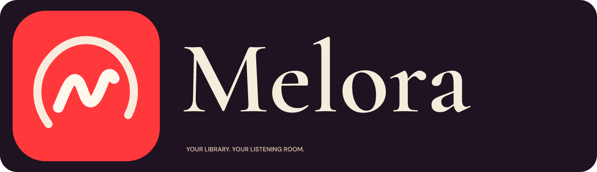
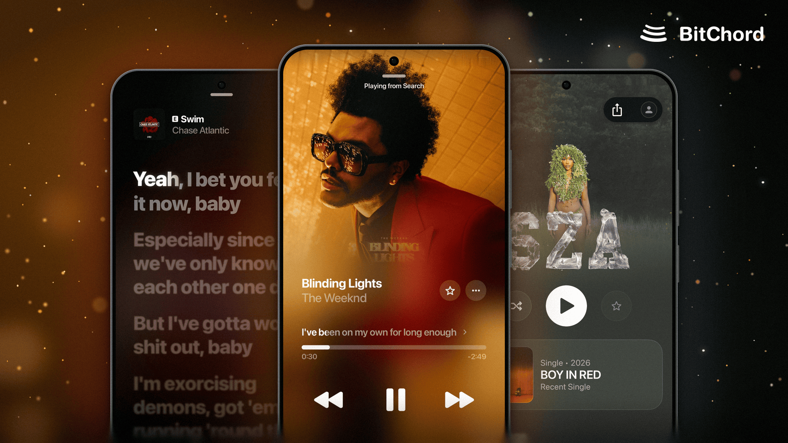

 
 

# Melora (formerly BitChord)

### Your music, beautifully played.

Melora is a design-led music player built around the music on your device. Browse a local library, play and organize your files, and use lyrics and audio tools alongside your collection. YouTube Music, Spotify, and other online sources remain optional integrations.

 

 

[**Download**](#download) · [**Features**](#features) · [**Contributing**](#contributing) · [**Support**](#support) · [**Disclaimer**](#disclaimer)

 

> [!IMPORTANT]
> Melora is not affiliated with, endorsed by, or connected to YouTube or Google in any way. Online integrations are optional; local playback does not require an online account.

---

<h1>Features</h1>

<table>
  <tr>
    <td width="50%" valign="top">

#### Your music
- **Local library playback** with albums, artists, folders, playlists, and downloads.
- **Embedded and online lyrics providers** for tracks in your collection.
- **High quality local playback**, including lossless formats supported by the device and player.
- **Gapless playback with true crossfade**, adjustable 0–12s.
- **Automix [Beta]** — DJ-style transitions with beat-matching and tempo-stretching.
- **Optional downloads** from configured online sources, with embedded metadata.
- **Background playback** via a proper foreground media session.

#### Optional integrations
- **YouTube Music** for online search, account features, and discovery.
- **Spotify integration** for playlists and Liked Songs.
- **Configurable audio sources** for additional streaming catalogs and quality tiers.
- **SMB, WebDAV, USB, and device storage** for personal music libraries.
- **Discord Rich Presence** — in-app login, live track/artist/album and progress.
- **Scrobbling** to Last.fm and ListenBrainz.

    </td>
    <td width="50%" valign="top">

#### Experience
- **Animated album canvas** — motion artwork on the now-playing screen.
- **Word-synced lyrics** — word/syllable-level highlighting from multiple sources.
- **Lyrics providers** — credit to [lrc.red](https://lrc.red), [BiniLyrics](https://github.com/binimum), [BetterLyrics](https://github.com/better-lyrics/better-lyrics), [PaxSenix](https://lyrics.paxsenix.org), [LyricsPlus](https://github.com/ibratabian17/YouLyPlus), [SimpMusic](https://github.com/maxrave-dev/SimpMusic), [Unison](https://unison.boidu.dev), [Megalobiz](https://www.megalobiz.com), [KuGou](https://www.kugou.com), [LRCLIB](https://lrclib.net), [Musixmatch](https://www.musixmatch.com) and [Genius](https://genius.com).
- **Dynamic, artwork-driven theming** — Material palette extracted from album art.
- **Frosted-glass UI** — Telegram-style translucent bars via Haze, Material 3 theming.

#### Controls & Tweaks
- **Per-network audio quality** — separate quality ceilings for Wi-Fi and mobile data.
- **Playback speed control** (0.5×–2.0×) and **skip silence**.
- **Sleep timer** — fixed presets or "stop after this track".
- **System equalizer** integration.
- **Bit-perfect USB exclusive output** — sends lossless tracks to a USB DAC unchanged, at each track's own rate and bit depth. Thanks to [Mornye](https://github.com/mornyeapp/Mornye) for the reference.
- **Stats for nerds** — codec, bit depth, sample rate, and more on the now-playing screen.

    </td>
  </tr>
</table>

---

<h1>Download</h1>

Grab the latest signed APK from the [Releases](https://github.com/kushagrasinghx/BitChord/releases) page. Sideloading requires enabling "Install unknown apps" for whichever app you download it with.

---

<h1>Contributing</h1>

We welcome contributions to BitChord! Please review our [Contributing Guide](CONTRIBUTING.md) and [Code of Conduct](CODE_OF_CONDUCT.md) before submitting a Pull Request.

[**Contributing Guide**](CONTRIBUTING.md) · [**Code of Conduct**](CODE_OF_CONDUCT.md) · [**Maintainers**](MAINTAINERS.md) · [**Additional Docs**](ADDITIONAL.md)

### Thanks to all contributors ❤

---

<h1>Support</h1>

BitChord is free and always will be — if it's earned a spot in your rotation, you can chip in here:

 

---

<h1>Disclaimer & Legal Notice</h1>

Melora is an independent, community-driven music player. It is **not** associated with Google LLC, YouTube Music, Deezer, Telegram, or any of their parent companies.

* **No Media Hosting:** Melora does not host or distribute music files. It plays files the user makes available and can connect to configured online sources.
* **Third-Party Services:** Users are responsible for complying with the terms and applicable laws for services they choose to connect.
* **No Ad-Blocking Guarantee:** While BitChord focuses on providing a clean listening environment, it does not guarantee permanent bypasses or modifications to commercial third-party platform conditions.
* **Copyleft:** BitChord is free software under the GPLv3. The license does not let anyone forbid others from selling or redistributing copies, but any distribution must come with the Corresponding Source under the same license.

---

<h1>License</h1>

This project is licensed under the **GNU General Public License v3.0 (GPLv3)**. See the [LICENSE](LICENSE) file for details.

